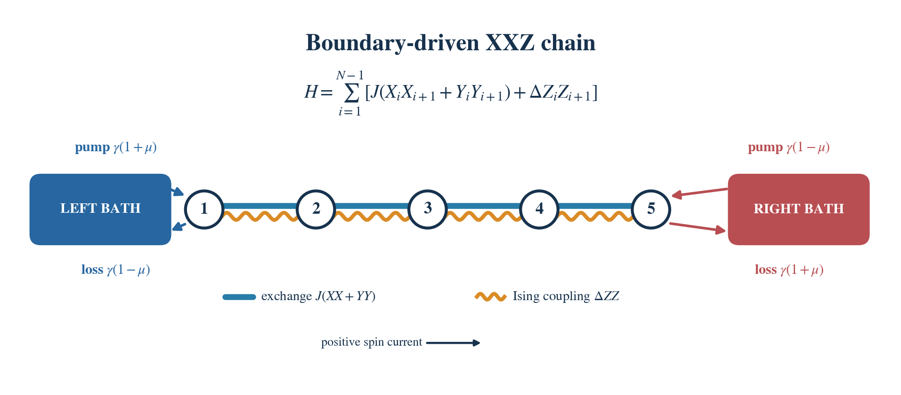

# BoundaryDrivenXXZ.jl



Five sites are drawn for illustration; the Hamiltonian and bath rates below
apply to a chain of any supported length.

Boundary reservoirs drive spin transport through an XXZ chain. The Julia
solver stores the density operator as an ITensorMPS matrix product state,
with each local ket/bra pair fused into a four-level index. This is an
MPDO/MPO representation; `density_mpo` returns the same state as an
`ITensorMPS.MPO` with separate ket and bra legs.

Exact two-site Liouvillian gates are applied in a second-order sweep.
For checks on up to four sites, `dense_evolve` independently constructs
the full Hamiltonian and jump operators.

The model is

$$
H=\sum_{i=1}^{N-1}\left[J(X_iX_{i+1}+Y_iY_{i+1})+\Delta Z_iZ_{i+1}\right],
$$

with left pump/loss rates `γ(1+μ)`/`γ(1−μ)` and right pump/loss rates `γ(1−μ)`/`γ(1+μ)`. Here `0 ≤ γ`, `|μ| ≤ 1`, and `N ≥ 2`. Positive current flows toward the right, with `jᵢ=2J(XᵢYᵢ₊₁−YᵢXᵢ₊₁)`. The bulk continuity equation is `d⟨Zᵢ⟩/dt = jᵢ₋₁−jᵢ`; edge source terms are `2γ(μ−⟨Z₁⟩)` and `−2γ(μ+⟨Zₙ⟩)`.

## Run

Julia 1.11 or newer and ITensors.jl/ITensorMPS.jl are required.

```bash
cd boundary_driven_xxz
julia --project=. -e 'using Pkg; Pkg.instantiate()'
julia --project=. test/runtests.jl
julia --project=. example.jl
julia --project=. benchmark.jl
```

Minimal use:

```julia
using BoundaryDrivenXXZ
model = Model(4; J=0.5, delta=0.3, gamma=0.5, mu=0.5)
state = evolve(model, 0.4; dt=0.02, cutoff=1e-12, maxdim=64)
obs = observables(model, state)
rho = density_matrix(model, state) # N ≤ 5, for inspection
mpo = density_mpo(model, state)     # separate physical ket/bra legs
```

The initial state is the maximally mixed density matrix. `evolve` also accepts a compatible fused-index MPS through `initial`. `observables` reports the trace, normalized magnetizations and currents, and edge source terms. `dense_steady_state` provides a trace-constrained dense NESS for at most four sites. It is a reference solve, not an MPO steady-state optimizer.


The implementation follows the documented [ITensorMPS gate API](https://docs.itensor.org/ITensorMPS/stable/MPSandMPO.html) and uses the boundary-driven XXZ setup discussed in [Prosen's 2011 paper](https://arxiv.org/abs/1106.2978). Dependencies retain their upstream licenses.

## License

This project is released under the [MIT License](LICENSE).
